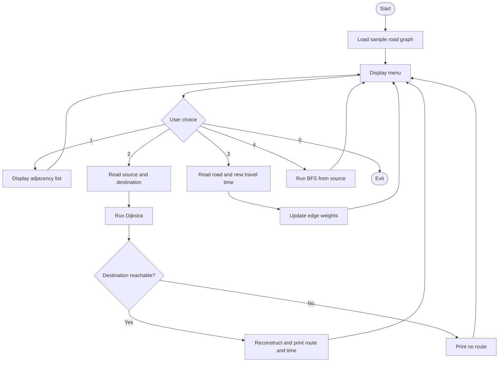

# Smart City Traffic Management System (ADS – C++)

An intermediate-level console project that models a city's road network as a **weighted graph** and computes a minimum-travel-time route using **Dijkstra's algorithm**. It also demonstrates BFS reachability and traffic updates.

## Problem statement
In a city, intersections/important places are connected by roads. Travel time changes with congestion. A traveler or traffic operator needs a route with the lowest estimated travel time, rather than simply the fewest roads.

## Objectives
- Represent locations and roads using an adjacency-list graph.
- Find a minimum-time route between two locations.
- Simulate congestion by changing a road's travel-time weight.
- Identify all locations reachable from a starting point.
- Explain complexity and practical limitations.

## ADS concepts
| Concept | Use |
|---|---|
| Weighted undirected graph | Models intersections/roads |
| Adjacency list | Stores only existing roads |
| Min-priority queue | Selects next closest vertex in Dijkstra |
| BFS + queue | Reachability traversal |
| Parent array | Reconstructs the selected route |
| Hash map | Maps location names to vertex indices |

## Project structure
```text
Smart_City_Traffic_Management/
├── src/main.cpp
├── web/index.html
├── docs/Project_Report.docx
├── docs/Project_Presentation.pptx
├── docs/flowchart.mmd
├── tests/test_cases.md
└── README.md
```

## Compile and run
Requires a C++17-compatible compiler.

**Linux / macOS**
```bash
g++ -std=c++17 -Wall -Wextra -pedantic src/main.cpp -o traffic
./traffic
```

**Windows (MinGW-w64)**
```bash
g++ -std=c++17 -Wall -Wextra -pedantic src/main.cpp -o traffic.exe
traffic.exe
```

## Demo locations
Central Station, City Hospital, Tech Park, Market Square, University, Airport, Bus Terminal.

For menu input, replace spaces with underscores, for example:
- Source: `Central_Station`
- Destination: `Airport`

The demo network is illustrative; travel times are sample values, not live traffic data.

## Algorithm: Dijkstra
1. Set all distances to infinity; source distance to zero.
2. Insert source into a min-priority queue.
3. Remove the state with minimum distance.
4. Ignore stale queue entries.
5. Relax each outgoing edge if a shorter distance is found.
6. Store the predecessor when a distance improves.
7. Reconstruct the route by following predecessors from destination to source.

**Time complexity:** `O((V + E) log V)` with an adjacency list and binary heap.  
**Space complexity:** `O(V + E)` for graph storage and `O(V)` auxiliary arrays/queue in the standard bound.

Dijkstra requires non-negative edge weights. This project accepts strictly positive travel times.

## Flowchart


## Web prototype
Open `web/index.html` in a modern browser. It is a self-contained educational simulation. It uses the same sample network and Dijkstra logic in JavaScript so that route selection can be demonstrated visually. The C++ console application is the primary ADS implementation.

## Test cases
See [`tests/test_cases.md`](tests/test_cases.md).

## Real-world applications
- Emergency vehicle routing (ambulance/fire services), subject to live road and dispatch data.
- Public transport planning and route guidance.
- Logistics and last-mile delivery.
- Road closure and congestion scenario analysis.
- City infrastructure planning and connectivity audits.

## Limitations and future enhancements
- Sample static data; no GPS, map provider, or live traffic feed.
- Roads are modeled as undirected; real streets may be one-way.
- Travel time is a single weight; no time-dependent traffic model.
- Future: directed edges, live sensor/API ingestion, A* search, time-dependent shortest paths, incident/road-closure handling, and map visualization.

## Suggested GitHub commit sequence
```bash
git init
git add README.md src/main.cpp
git commit -m "Day 1: Add traffic network graph and project README"

git add web/index.html
git commit -m "Day 2: Build interactive route finder prototype"

git add docs tests
git commit -m "Day 3: Add flowchart, test cases and project documentation"

git branch -M main
git remote add origin https://github.com/<YOUR-USERNAME>/smart-city-traffic-management.git
git push -u origin main
```
Do not copy a commit command until the corresponding files are complete and tested. Replace `<YOUR-USERNAME>` with your GitHub username.
